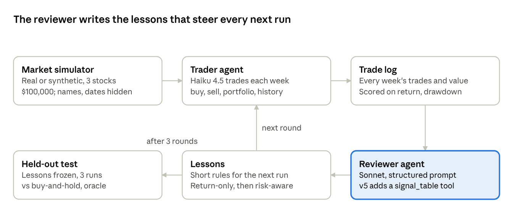
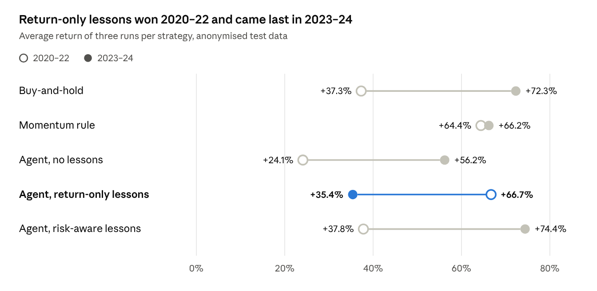
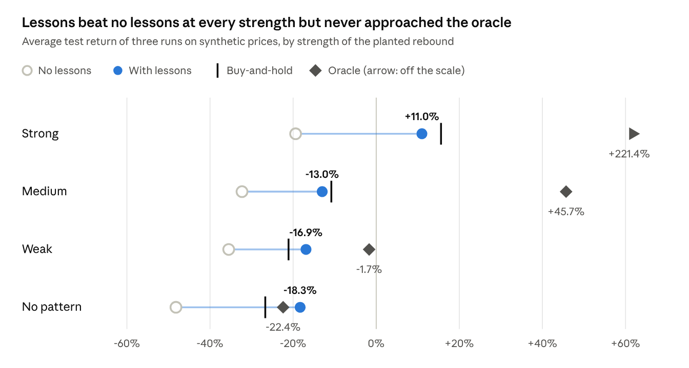

# Agent-fun: Project Write-up

## Overview

Reflection makes a weekly stock-trading agent better by removing its bad habits, but in this project it never found a real edge, not even one planted in the data. Agent-fun gave a trader agent $100,000, weekly prices for AAPL, MSFT and GOOGL, and four tools (get portfolio, buy, sell, get price history). A second agent reviewed each run and wrote lessons for the next one.

On real prices, reflection lifted the agent from +24.1% to +66.7% on 2020–22, then fell to +35.4% on 2023–24, behind buy-and-hold at +72.3%. A risk-aware reviewer fixed that, but only by steering the agent into buy-and-hold. On synthetic prices with a planted rebound pattern, an oracle made +221.4% and the agent with lessons +11.0%. Once the reviewer had an analysis tool it measured the pattern, but the trader never acted on it.

## The story

The project ran in nine chapters, each answering the doubt the previous one raised: five on real prices, then four on synthetic prices with a known answer. Each setting ran three times; 2020–22 runs cover about 146 weeks, 2023–24 and synthetic runs about 95.

### 1. The naive agent looked smart, but it was remembering

On real 2020–22 prices the agent averaged +44.6% against +37.3% for buy-and-hold. Its reasoning gave it away: it called Apple "one of the most stable, profitable, and innovation-driven companies", named COVID in February 2020, and quoted the Fed when it went to cash in 2022. None of that was in the data.

With tickers renamed to STOCK_A/B/C and dates hidden, the average fell to +24.1%, and the agent lost to buy-and-hold in all three runs. The apparent edge was training-data memory, not price reading.

### 2. The reviewer invented evidence until it had structure

The first reviewer (Haiku, short prompt) blamed transaction costs the market did not have, and cited trades that never happened. About half its quoted rows were correct. Switching to Sonnet with a structured prompt got 11 of 11 quoted rows right and found the real problem period, weeks 69–134.

### 3. Reflection worked, as momentum rotation

Trained on 2018–20 and tested on anonymised 2020–22, the lessons lifted the agent to +66.7% with zero leaks. Trades dropped from about 250 to about 18. The agent went 100% into whichever stock had been strongest, switching 8–10 times in three years.

A 15-line momentum rule picked on the same training data made +64.4%. So most of the gain came from the strategy the lessons led to; the agent beat the rule mainly on drawdown (−32.7% vs −39.6%). Training scores did not track this: round 3 trained worst (+52.1%) but its lessons tested best.

### 4. It did not generalise

The same lessons on 2023–24 averaged +35.4%, the worst of every strategy, against +56.2% with no lessons and +72.3% for buy-and-hold. One run made +14.3%. A concentrated single-stock style that won in one market lost in the next.

### 5. The objective was the cause

The reviewer had been told to beat buy-and-hold on return only, and never saw risk. A risk-aware reviewer, told to beat buy-and-hold without more risk and shown drawdown, stopped the all-in behaviour. The agent then matched buy-and-hold in both periods: +37.8% on 2020–22 and +74.4% on 2023–24.

It got there by becoming buy-and-hold. Its first lesson read: "Hold the starting mix by default." Reflection optimises the objective it is given, including in ways nobody intended, and you steer it by what the reviewer is told and what it can see.

### 6. A test with a known right answer

On real prices there was no way to tell "no edge exists" from "reflection can't find one". So the next step was a positive control: synthetic prices with a pattern planted in them, and an oracle that trades it perfectly.

The planted pattern is a rebound. When a stock falls more than 4% in a week, it gets extra daily return for the next five days. It was chosen because it runs against the agent's habit of selling after a sharp drop.

The prices are random walks for three stocks, S1–S3, over 504 trading days, with separate train and test seeds. The rebound comes in four strengths: strong (+1.0% a day), medium (+0.4%), weak (+0.15%) and none. On the strong test set the oracle, which buys whatever just dropped, made +221.4% against +15.6% for buy-and-hold. With no pattern its edge shrank to +4.3 points, so the pattern is real and its size is known.

### 7. Reflection improved returns, but not through the pattern

The risk-aware reviewer, now also shown each stock's weekly move, trained at all four strengths (v3). Lessons beat no lessons everywhere, but the gains ran backwards. The score is the share of the gap to the oracle that the lessons closed: (lessons − no lessons) / (oracle − no lessons).

| Pattern strength | Share of gap closed |
| --- | --- |
| Strong | 13% |
| Medium | 25% |
| Weak | 55% |
| None | 116% |

Reflection did best where the pattern was weakest, and better than "perfect" where there was none. Two things explain it:

1. With no lessons the agent traded about 175 times and kept about 70% in one stock, losing far more than buy-and-hold at every strength. The lessons stopped that.
2. At medium, weak and none, the lessons said to sell stocks that fall for several weeks and keep the cash. The test seeds happened to fall, so cash beat buy-and-hold by luck, not strategy.

The closest the reviewer came was a strong-run lesson: "Do not sell after one drop… selling a dip was repeatedly followed by a reversal." It saw the rebound but never said to buy the dip. Three explanations were left:

1. **The cap.** Trading a rebound means adding to the stock that just fell; the risk-aware lessons capped each position near 40%.
2. **No exploration.** The reviewer only sees what the agent did, and the agent never bought dips, so the record held almost no rewarded examples.
3. **No statistics.** Spotting "a drop over 4% is followed by about +5%" means comparing about 285 stock-weeks. A model reading a text table spots striking examples, not averages.

### 8. Removing the risk goal changed nothing

v4 dropped the risk goal from the reviewer on the strong pattern, to test the cap explanation. The test average was +16.0%, level with buy-and-hold at +15.6%. The reviewer saw the same half-pattern, "Large one-week moves often reverse the next week", and again concluded "don't sell after a drop", never "buy after a drop". Its final lessons said to invest equally on day one and hold. The cap was not the cause.

### 9. A measuring tool found the pattern; the trader didn't use it

v5 gave the reviewer `signal_table`, a tool that sorts every stock-week into five groups by a signal (own 1-week or 4-week move, market move, move against the market) and reports the average return 1–4 weeks later. The reviewer called it and found the rebound: "The worst 1-week losers rebounded by about +3% on average the next week (75% positive)."

The test average was still +15.2%, against +15.6% for buy-and-hold. The lessons did turn the finding into a rule, "don't sell a stock because it fell 3% or more", but kept the 40% cap and equal weights, allowing only a modest dip-buy. The trader also did not carry out even that plan.

What this shows: reflection reliably improves an agent by removing harmful default behaviour, and a tool can let it find a real pattern. Finding a pattern and acting on it are separate problems. Return scores alone would have hidden this; behaviour-level checks against an oracle exposed it.

## How it was built

Each training round runs the trader through the training prices (real 2018–20, or a synthetic train set), then the reviewer reads the log and rewrites the lessons. After three rounds the final lessons are frozen and tested on periods the agent never trained on. The code uses the Claude Agent SDK, with the market exposed to the trader as tools.

## Results

*Source: `experiments/runs` and `docs/findings.md` · 3 runs per strategy per period*

Only the risk-aware lessons kept pace with buy-and-hold in both periods, and with the same drawdown: −34.1% vs −33.9% on 2020–22, −14.1% vs −14.4% on 2023–24.

*Source: `experiments/runs/reflexion_v3_*` and `docs/findings.md` · synthetic test sets, 3 runs each*

On synthetic prices the lessons stayed close to buy-and-hold while the oracle's lead grew with the pattern, to +205.8 points at full strength. The strong-pattern follow-ups landed in the same place: +16.0% without the risk goal (v4) and +15.2% with the analysis tool (v5).

## Where to find it

The full run-by-run notes are in [`docs/findings.md`](docs/findings.md).

| Path | What it holds |
| --- | --- |
| `agent/` | Trader agent, its tools, memory, state, the reviewer, and the `signal_table` analysis tool |
| `environment/` | Weekly market simulator, price download, anonymiser, synthetic price generator, oracle check, buy-and-hold and momentum baselines |
| `evaluation/` | Runner (train rounds, tests, holdout, risk and synthetic experiments), graders, metrics |
| `data/` | Daily closes: 2018–20 (train), 2020–22 (test), 2023–24 (holdout); `data/synthetic/` holds train and test sets at four pattern strengths |
| `experiments/` | Baseline logs, every reflexion run (v1–v5) as JSONL plus result JSON, and each lesson set with its review |
| `docs/findings.md` | Run notes, reviewer audit, result tables |
